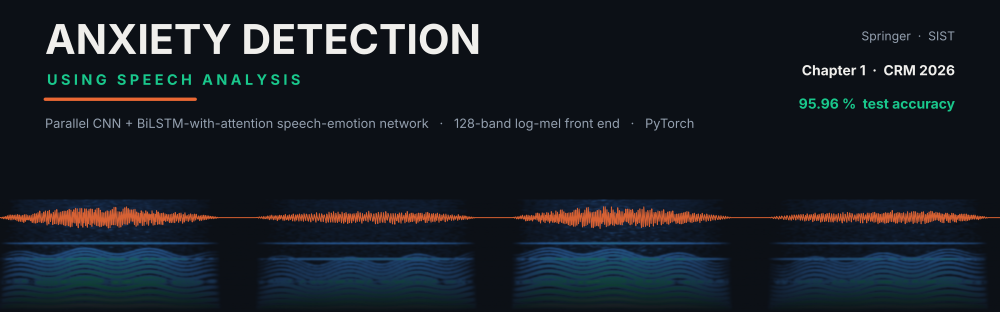
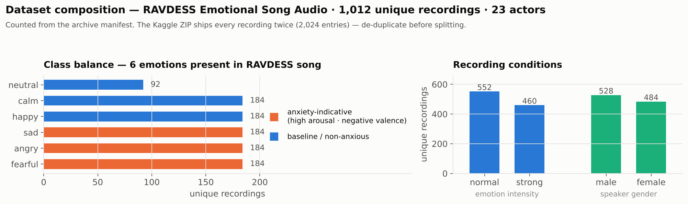
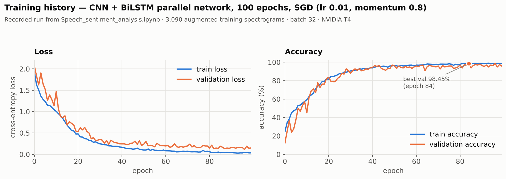
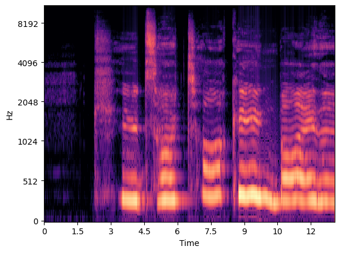
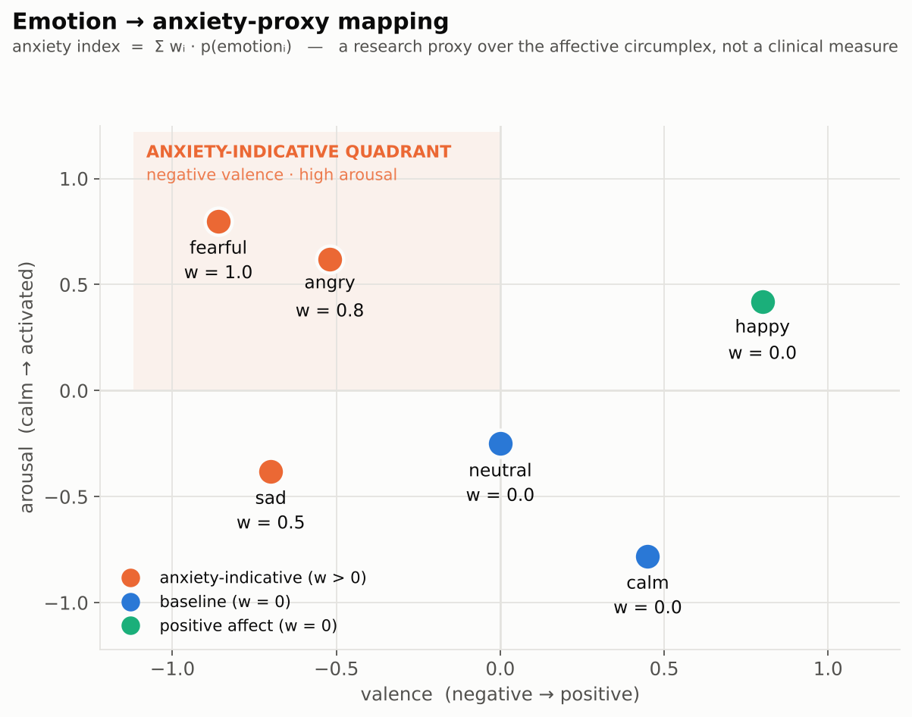
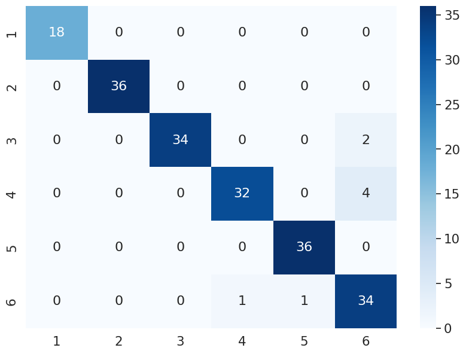
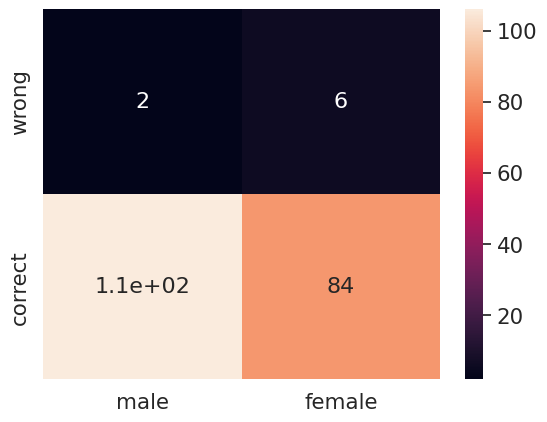
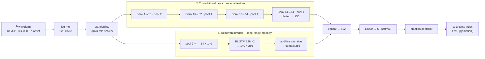

<div align="center">



# 🎙️🧠 Anxiety Detection Using Speech Analysis

### *Three seconds of voice in. A calibrated read on affective state out.*

**Parallel CNN + BiLSTM-with-attention speech-emotion network — the acoustic stream of a published dual-stream anxiety model**


[](https://doi.org/10.1007/978-981-96-8126-6_1)
[](https://doi.org/10.1007/978-981-96-8126-6_1)

### 📖 **[Read the chapter on SpringerLink →](https://link.springer.com/chapter/10.1007/978-981-96-8126-6_1)**

***Dual-Stream Anxiety Detection: LSTM-Based Speech Analysis and CNN-Driven Sentiment Analysis***
Adrija Basu · Akanksha Mishra · Aditya Roy · **Aparijit Chakraborty** · R. Hariharan
*Proceedings of the Third Congress on Control, Robotics, and Mechatronics* — **Chapter 1, pp. 1–15**
Smart Innovation, Systems and Technologies · Springer Nature Singapore · 2026

</div>

---

## 💡 What this is

Anxious speech does not announce itself in *what* people say — it shows up in
**how** they say it: a tightened pitch contour, a faster and more uneven
rhythm, a breathier onset, a tremor that a listener feels before they can
name it. This repository turns three seconds of audio into a measurement of
that signal.

A single 128-band log-mel spectrogram is read **twice, in parallel**:

```
🎙️ 3 s @ 48 kHz ──► log-mel 128 × 563 ──┬──► 4× Conv-BN-ReLU-Pool ──► 256-d  ┐
                                         │     local spectral texture          ├──► concat 512 ──► softmax ──► anxiety index
                                         └──► BiLSTM-128 + attention ──► 256-d ┘
                                               long-range prosody
```

The convolutional branch sees the spectrogram as an **image** and learns
formant shape, harmonic spacing and onset bursts. The recurrent branch reads
it as a **sequence** and learns intonation contour and pacing, with attention
deciding *which moment* of the clip carried the emotion. Neither view is
enough alone; fused, they reach **95.96 % test accuracy** with only 263,593
parameters.

> [!IMPORTANT]
> The model classifies **acted emotion** and projects it onto an anxiety
> index. It is a research proxy for affective tone — **not a clinical
> instrument**, and never a basis for a decision about a person.
> See the [model card](docs/MODEL_CARD.md).

## 🖼️ Gallery

<table>
<tr>
<td width="50%" align="center">
  <br/>
  <sub><b>Dataset</b> · 1,012 unique recordings, 23 actors, 6 emotions — and the duplication trap in the Kaggle mirror</sub>
</td>
<td width="50%" align="center">
  <br/>
  <sub><b>Training</b> · 100 epochs, no overfitting gap, best validation 98.45 %</sub>
</td>
</tr>
<tr>
<td width="50%" align="center">
  <br/>
  <sub><b>Features</b> · the 128 × 563 log-mel spectrogram the network sees</sub>
</td>
<td width="50%" align="center">
  <br/>
  <sub><b>Mapping</b> · emotion posterior → anxiety index on the valence–arousal plane</sub>
</td>
</tr>
<tr>
<td width="50%" align="center">
  <br/>
  <sub><b>Confusion matrix</b> · near-diagonal over the 198-clip test fold</sub>
</td>
<td width="50%" align="center">
  <br/>
  <sub><b>Subgroups</b> · balanced across male and female speakers</sub>
</td>
</tr>
</table>

<div align="center">

**[→ Full gallery with provenance for every figure](docs/GALLERY.md)**

</div>

## 📊 Results

| Metric | Value |
|---|---|
| **Test accuracy** | **95.96 %** |
| Test loss | 0.120 |
| Weighted recall | 0.96 |
| Weighted F1 | 0.96 |
| Best validation accuracy | 98.45 % (epoch 84) |
| Trainable parameters | 263,593 |
| Training time | 100 epochs on one NVIDIA T4 |

<details>
<summary><b>⚠️ How to read 95.96 % — the honest version (click to expand)</b></summary>

<br/>

That number is a faithful report of the run that was executed, and two
properties of that run inflate it relative to unseen speakers:

1. **The Kaggle archive ships every recording twice** — 2,024 entries for
   1,012 unique recordings, once under `Actor_XX/` and once under
   `audio_song_actors_01-24/Actor_XX/`. The notebook indexed 1,936 rows, so a
   random split can place a file and its byte-identical twin on opposite
   sides.
2. **The split is not speaker-independent.** Even de-duplicated, a stratified
   random split shares actors between train and test, so the model can score
   partly by recognising *how a particular actor performs fear*.

Neither is a flaw in the architecture — it is how the headline should be
read. This repository therefore makes the leakage-safe protocol the
**default**:

```bash
python -m anxiety_speech.train --data-root data/ravdess --split speaker
```

and puts the published protocol behind explicit opt-in flags
(`--split stratified --keep-duplicates`). Speaker-independent numbers are
deliberately **not** quoted anywhere here, because that run has not been
executed in this repository. Full discussion: [`docs/RESULTS.md`](docs/RESULTS.md).

</details>

## 🏗️ Architecture



Every tensor shape, every design decision and the attention mathematics are
laid out in [`docs/ARCHITECTURE.md`](docs/ARCHITECTURE.md).

## 🧬 Tools & tech stack

| Layer | Technology | Role in this project |
|---|---|---|
| 🎧 **Audio I/O** | `librosa` · `soundfile` | 48 kHz loading, fixed 3 s windowing at a 0.5 s offset |
| 🌈 **Feature front end** | `librosa.feature.melspectrogram` | 128-band log-mel, `n_fft 1024` · Hamming 512 · hop 256 → 128 × 563 |
| 🔊 **Augmentation** | `NumPy` | additive white Gaussian noise at a sampled 15–30 dB SNR |
| 🧱 **Convolutional branch** | `PyTorch` `Conv2d` · `BatchNorm2d` · `MaxPool2d` · `Dropout` | 4 blocks → 256-d spectro-temporal texture embedding |
| 🔁 **Recurrent branch** | `PyTorch` `LSTM` (bidirectional) | 140-step sequence over 64 mel bands → 140 × 256 |
| 🎯 **Attention** | additive (Bahdanau-style) scoring | softmax over time → 256-d context vector |
| 📐 **Normalisation** | `scikit-learn`-style per-feature scaler, serialised in the checkpoint | train-fold statistics reused at inference |
| 📈 **Optimisation** | SGD · lr 0.01 · momentum 0.8 · weight decay 1e-3 | 100 epochs, batch 32, cross-entropy |
| 📊 **Metrics** | `scikit-learn` | accuracy, weighted/macro F1, recall, confusion matrix, subgroup breakdown |
| 🖼️ **Visualisation** | `matplotlib` · `seaborn` | training curves, confusion matrix, dataset and mapping figures |
| ⚡ **Hardware** | NVIDIA T4 (Colab) | ~263 K parameters — trains on one GPU, runs on CPU |
| ✅ **Quality** | `pytest` · GitHub Actions | 10 tests on a synthetic corpus, no download required |

## 🚀 Quickstart

```bash
git clone https://github.com/aparijit05072004/Anxiety-detectionn-using-speech-analysis.git
cd Anxiety-detectionn-using-speech-analysis
pip install -r requirements.txt
```

```bash
pytest -q tests/          # 10 tests, synthetic audio, no dataset needed
```

**Get the corpus** (needs a Kaggle token at `~/.kaggle/kaggle.json`):

```bash
bash scripts/download_dataset.sh data/ravdess
```

**Train** — speaker-independent by default, so no actor is shared between folds:

```bash
cd src
python -m anxiety_speech.train --data-root ../data/ravdess --split speaker --out ../artifacts
```

**Evaluate** — metrics, confusion matrix, and accuracy by gender and intensity:

```bash
python -m anxiety_speech.evaluate \
    --checkpoint ../artifacts/best_model.pt \
    --split-csv  ../artifacts/split_test.csv \
    --out        ../artifacts
```

**Score a clip:**

```bash
python -m anxiety_speech.predict -c ../artifacts/best_model.pt sample.wav
```

```
file          anxiety  band       emotion
sample.wav      0.812  high       fearful (79.4%)
```

<details>
<summary><b>Use it as a library</b></summary>

```python
from anxiety_speech.data import build_index, split_by_speaker
from anxiety_speech.evaluate import load_checkpoint
from anxiety_speech.predict import predict_files

frame = build_index("data/ravdess")           # de-duplicates automatically
train, val, test = split_by_speaker(frame)    # no actor shared across folds

result = predict_files("artifacts/best_model.pt", ["clip.wav"])[0]
print(result["anxiety_index"], result["band"], result["emotion"])
```

</details>

<details>
<summary><b>Reproduce the published run exactly (leak included)</b></summary>

```bash
python -m anxiety_speech.train --data-root ../data/ravdess \
    --split stratified --keep-duplicates --epochs 100
```

Both flags are deliberately explicit — reproducing a leak should require
asking for it.

</details>

## 📁 Repository layout

```
Speech_sentiment_analysis.ipynb    the executed research notebook (as published)
src/anxiety_speech/
├── config.py       every hyper-parameter, in one place
├── data.py         RAVDESS indexing · de-duplication · speaker-independent splits
├── features.py     log-mel front end · fixed windowing · serialisable scaler
├── augment.py      AWGN at a sampled SNR
├── model.py        parallel CNN + BiLSTM-with-attention network
├── anxiety.py      emotion posterior → anxiety index and bands
├── train.py        training CLI · history + checkpoint
├── evaluate.py     metrics · confusion matrix · subgroup breakdown
└── predict.py      single-clip / batch inference CLI
tests/              10 pytest cases on a synthetic corpus
scripts/            dataset download with a duplication check
docs/
├── ARCHITECTURE.md  tensor-by-tensor walk-through and design rationale
├── DATASET.md       dataset card · filename schema · the duplication trap
├── METHODOLOGY.md   the pipeline end to end, in order
├── RESULTS.md       measured numbers and how to read them
├── MODEL_CARD.md    intended use · limitations · ethics
├── PUBLICATION.md   the chapter, and how to cite it
├── GALLERY.md       every figure, with provenance
├── data/            training_history.csv · dataset_composition.csv
└── images/          generated figures + authentic notebook outputs
```

## 📚 Documentation

| Document | What it answers |
|---|---|
| 🏗️ [`ARCHITECTURE.md`](docs/ARCHITECTURE.md) | How the two branches work, every tensor shape, why each choice |
| 📊 [`DATASET.md`](docs/DATASET.md) | What RAVDESS song contains — and the duplicate-file trap |
| 🔬 [`METHODOLOGY.md`](docs/METHODOLOGY.md) | The full pipeline, in the order data moves through it |
| 📈 [`RESULTS.md`](docs/RESULTS.md) | The measured numbers, and how to read them honestly |
| 🧾 [`MODEL_CARD.md`](docs/MODEL_CARD.md) | Intended use, limitations, ethics, dual-use risk |
| 📄 [`PUBLICATION.md`](docs/PUBLICATION.md) | The chapter record and citation formats |
| 🖼️ [`GALLERY.md`](docs/GALLERY.md) | Every figure, captioned, with its provenance |

## 🔭 Where this goes next

- [ ] **Speaker-independent benchmark** — run the default protocol and publish the number
- [ ] **Cross-corpus validation** — CREMA-D, TESS, SAVEE, IEMOCAP
- [ ] **Fuse the text stream** — join the CNN sentiment pathway from the chapter
- [ ] **Attention visualisation** — overlay the weights on the spectrogram to show *when* the model listened
- [ ] **Calibration** — temperature scaling, so the anxiety index behaves like a probability
- [ ] **Spontaneous speech** — the only route to a claim about anxiety rather than acted affect

## 📖 Citation

<details open>
<summary><b>BibTeX</b></summary>

```bibtex
@inbook{Basu2026DualStream,
  title     = {Dual-Stream Anxiety Detection: LSTM-Based Speech Analysis
               and CNN-Driven Sentiment Analysis},
  author    = {Basu, Adrija and Mishra, Akanksha and Roy, Aditya
               and Chakraborty, Aparijit and Hariharan, R.},
  booktitle = {Proceedings of the Third Congress on Control, Robotics,
               and Mechatronics},
  series    = {Smart Innovation, Systems and Technologies},
  publisher = {Springer Nature Singapore},
  year      = {2026},
  pages     = {1--15},
  doi       = {10.1007/978-981-96-8126-6_1}
}
```

</details>

APA and IEEE forms, plus the RAVDESS dataset citation, are in
[`docs/PUBLICATION.md`](docs/PUBLICATION.md). A machine-readable
[`CITATION.cff`](CITATION.cff) powers GitHub's *Cite this repository* button.

## ⚖️ Licence & responsible use

The **RAVDESS** corpus is licensed **CC BY-NC-SA 4.0** — non-commercial,
share-alike — and any model trained on it inherits that restriction. Voice is
biometric data: treat recordings as sensitive personal data, obtain informed
and revocable consent, and never use this model to make a consequential
decision about a person. The [model card](docs/MODEL_CARD.md) sets out the
boundaries in full.

<div align="center">

---

**Anxiety Detection Using Speech Analysis**
log-mel spectrograms × convolutional texture × recurrent prosody × temporal attention

Published in *Smart Innovation, Systems and Technologies* · Springer Nature Singapore · 2026
[](https://doi.org/10.1007/978-981-96-8126-6_1)

</div>
