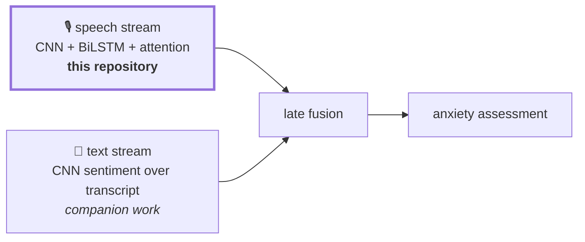

# 🏗️ Architecture

> The speech stream of the dual-stream anxiety-detection model
> ([Springer, 2026](https://doi.org/10.1007/978-981-96-8126-6_1)).

The network reads **one 3-second log-mel spectrogram** and answers two
questions at once, with two branches that see the same input differently:

| Branch | Sees | Captures | Output |
|---|---|---|---|
| **Convolutional** | the spectrogram as a 2-D *image* | local spectro-temporal texture — formant shape, harmonic spacing, breathiness, onset bursts | 256-d |
| **Recurrent + attention** | the spectrogram as a *sequence* of frames | long-range prosody — intonation contour, pacing, tremor, where in the clip the emotion actually lives | 256-d |

Neither view is sufficient alone. A CNN flattens time; an LSTM over raw mel
bands misses fine harmonic structure. Running them **in parallel** and
concatenating the embeddings lets a single linear layer weigh both.

```mermaid
flowchart LR
    A["🎙️ waveform<br/>48 kHz · 3 s from 0.5 s offset<br/>144,000 samples"] --> B["log-mel spectrogram<br/>n_fft 1024 · win 512 · hop 256<br/>Hamming · 128 mels → 128 × 563"]
    B --> C["per-feature standardisation<br/>(scaler fitted on train fold only)"]

    subgraph CNN["🧱 Convolutional branch"]
        direction TB
        D["block 1 · Conv 1→16 · BN · ReLU<br/>MaxPool 2 · Dropout 0.3<br/>→ 16 × 64 × 281"]
        D --> E["block 2 · Conv 16→32 · BN · ReLU<br/>MaxPool 4 · Dropout 0.3<br/>→ 32 × 16 × 70"]
        E --> F["block 3 · Conv 32→64 · BN · ReLU<br/>MaxPool 4 · Dropout 0.3<br/>→ 64 × 4 × 17"]
        F --> G["block 4 · Conv 64→64 · BN · ReLU<br/>MaxPool 4 · Dropout 0.3<br/>→ 64 × 1 × 4 → flatten 256"]
    end

    subgraph RNN["🔁 Recurrent branch"]
        direction TB
        H["MaxPool 2×4<br/>→ 64 mels × 140 frames"]
        H --> I["transpose to sequence<br/>140 steps × 64 features"]
        I --> J["BiLSTM · hidden 128 each way<br/>→ 140 × 256 · Dropout 0.1"]
        J --> K["additive attention<br/>softmax over 140 steps<br/>→ context 256"]
    end

    C --> D
    C --> H
    G --> L["concatenate → 512"]
    K --> L
    L --> M["Linear 512 → 6<br/>softmax"]
    M --> N["emotion posterior"]
    N --> O["⚠️ anxiety index<br/>Σ wᵢ · p(emotionᵢ)"]
```

## Tensor walk-through

Every shape below is what actually flows through `src/anxiety_speech/model.py`
for the published configuration.

| Stage | Shape | Note |
|---|---|---|
| waveform | `(144000,)` | 3 s at 48 kHz, padded or trimmed |
| log-mel (dB) | `(128, 563)` | `563 = 144000 / 256 + 1` |
| model input | `(B, 1, 128, 563)` | single channel |
| conv block 1 → 4 | `(B, 64, 1, 4)` | pooling 2 → 4 → 4 → 4 |
| conv embedding | `(B, 256)` | flattened |
| LSTM input | `(B, 140, 64)` | pooled `(2,4)`, then transposed |
| BiLSTM output | `(B, 140, 256)` | 128 units each direction |
| attention weights | `(B, 1, 140)` | sums to 1 over time |
| attention context | `(B, 256)` | weighted mean of LSTM states |
| fused embedding | `(B, 512)` | concatenation |
| logits | `(B, 6)` | 6 emotions in the song subset |

**263,593 trainable parameters** with the 8-class head used in the published
notebook run — small enough to train on a single T4 in roughly half an hour,
and small enough to run on CPU at inference.

## Attention

The recurrent branch scores every one of the 140 time steps with a learned
linear projection, normalises the scores with a softmax, and takes the
weighted mean of the BiLSTM states:

$$\alpha_t = \frac{\exp(w^\top h_t)}{\sum_{\tau} \exp(w^\top h_\tau)}, \qquad
c = \sum_t \alpha_t\, h_t$$

This matters for emotional speech: the emotionally loaded part of an utterance
is rarely spread evenly across three seconds. The weights are returned by
`forward()` as a third output, so they can be plotted over the spectrogram to
show *which* moment drove a prediction.

> **Implementation note.** The notebook scores the time steps in a Python
> `for` loop; `model.py` evaluates the identical projection as a single
> matrix multiply. The mathematics is unchanged — it is the same additive
> attention — but a batch no longer costs 140 sequential kernel launches.

## Design decisions, and why

| Decision | Reason |
|---|---|
| **Log-mel, not MFCC** | MFCCs decorrelate and discard spectral detail that a CNN can exploit directly. The mel scale already matches human pitch perception. |
| **3 s window at a 0.5 s offset** | RAVDESS takes begin with a short silence; the offset skips it, and a fixed window keeps every tensor the same shape without a ragged-batch collate. |
| **Dropout 0.3 in conv blocks, 0.1 in the LSTM** | The convolutional branch has far more capacity relative to 1,012 recordings and needs the heavier regulariser. |
| **BatchNorm after every conv** | Spectrogram dB values span a wide dynamic range; normalising per channel keeps the deep blocks trainable with plain SGD. |
| **SGD with momentum, not Adam** | Reproduces the published run. Adam converges faster here but was not what was reported. |
| **Softmax returned alongside logits** | The loss needs logits; the anxiety index needs a calibrated-ish posterior. Returning both avoids recomputing. |

## Where the second stream fits

The published chapter pairs this speech pathway with a **CNN-driven sentiment
analysis** stream over transcribed text. This repository implements the
**speech stream only** — the acoustic pathway and its evaluation. The text
stream lives in the companion work; a fusion layer would combine the two
posteriors before the anxiety mapping.

