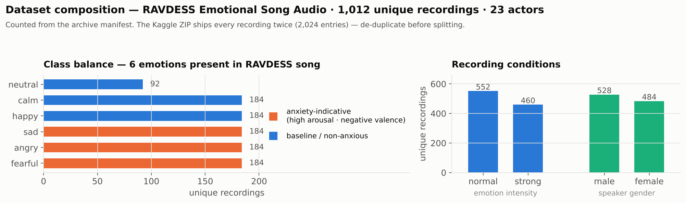

# 📊 Dataset card — RAVDESS Emotional Song Audio

| | |
|---|---|
| **Source** | [RAVDESS](https://zenodo.org/record/1188976) — Ryerson Audio-Visual Database of Emotional Speech and Song |
| **Mirror used** | Kaggle · [`uwrfkaggler/ravdess-emotional-song-audio`](https://www.kaggle.com/datasets/uwrfkaggler/ravdess-emotional-song-audio) |
| **Licence** | CC BY-NC-SA 4.0 — non-commercial, share-alike |
| **Modality** | audio-only, *sung* speech (RAVDESS modality `03`, vocal channel `02`) |
| **Unique recordings** | **1,012** |
| **Archive entries** | **2,024** — every file is shipped twice (see the warning below) |
| **Actors** | 23 professional actors (12 male, 11 female; actor 18 has no song recordings) |
| **Emotions** | 6 — neutral, calm, happy, sad, angry, fearful |
| **Sample rate** | 48 kHz |
| **Download size** | ≈ 456 MB |

<p align="center">
  
</p>

## ⚠️ The archive contains every recording twice

This is the single most important thing to know before training on this mirror.

The Kaggle ZIP unpacks **two copies of the full corpus**:

```
ravdess-emotional-song-audio/
├── Actor_01/ … Actor_24/                    ← 1,012 files
└── audio_song_actors_01-24/
    └── Actor_01/ … Actor_24/                ← the same 1,012 files again
```

A plain `os.walk` over the extraction directory therefore returns **2,024
paths for 1,012 recordings**, and a random train/test split will place a file
and its byte-identical twin on opposite sides of the split. The model then
sees part of its test set during training, and the reported test accuracy is
optimistic by an unknown margin.

`anxiety_speech.data.build_index()` de-duplicates on the filename stem by
default and logs a warning when it does:

```python
from anxiety_speech.data import build_index

frame = build_index("data/ravdess")                       # 1,012 rows
leaky = build_index("data/ravdess", deduplicate=False)    # 2,024 rows
```

The published notebook indexed **1,936 rows** — roughly twice the unique
count — so its split is affected. See [`RESULTS.md`](RESULTS.md) for what that
means for the headline number.

## Filename schema

Every RAVDESS filename is a seven-field identifier:

```
03-02-06-02-01-02-12.wav
│  │  │  │  │  │  └── actor        12  → even = female, odd = male
│  │  │  │  │  └───── repetition   02
│  │  │  │  └──────── statement    01 = "Kids are talking by the door"
│  │  │  │                         02 = "Dogs are sitting by the door"
│  │  │  └─────────── intensity    01 = normal, 02 = strong
│  │  └────────────── emotion      06 = fearful
│  └───────────────── vocal channel 02 = song
└──────────────────── modality     03 = audio-only
```

Parsed by `anxiety_speech.data.parse_filename()`, which also rejects anything
that is not an audio-only song clip.

## Composition

### Emotion × intensity (unique recordings)

| Emotion | Code | Normal | Strong | Total | Anxiety weight |
|---|---|---:|---:|---:|---:|
| neutral | 01 | 92 | — | **92** | 0.0 |
| calm | 02 | 92 | 92 | **184** | 0.0 |
| happy | 03 | 92 | 92 | **184** | 0.0 |
| sad | 04 | 92 | 92 | **184** | 0.5 |
| angry | 05 | 92 | 92 | **184** | 0.8 |
| fearful | 06 | 92 | 92 | **184** | 1.0 |
| | | **552** | **460** | **1,012** | |

Only **neutral** is under-represented, because RAVDESS records neutral at
normal intensity only. The remaining five classes are exactly balanced.

### Speakers

| | Actors | Recordings |
|---|---:|---:|
| male (odd ids) | 12 | 528 |
| female (even ids) | 11 | 484 |

### Emotions that are *not* here

RAVDESS defines eight emotions, but **disgust (07)** and **surprise (08)** are
recorded for the *speech* subset only. Training an 8-way head on the song
subset — as the published notebook does — leaves two classes with zero
examples; they can never be predicted and contribute nothing but unused
parameters. `anxiety_speech` uses a **6-class head** and maps the RAVDESS
codes explicitly in `config.RAVDESS_CODE_TO_LABEL`.

## Getting the data

```bash
# 1. Put a Kaggle API token at ~/.kaggle/kaggle.json (chmod 600)
# 2. Then:
bash scripts/download_dataset.sh data/ravdess
```

The script downloads, unpacks, and reports both the raw entry count and the
de-duplicated count so the duplication is visible before you train.

## Fitness for purpose — read before reporting a number

- **Acted, not clinical.** Professional actors performing an emotion on cue.
  Acted affect is more prototypical and more separable than spontaneous
  affect; absolute accuracy here is an upper bound on in-the-wild behaviour.
- **Sung, not spoken.** The song subset constrains pitch and rhythm to a
  melody, which removes much of the natural prosodic variation anxious speech
  would show.
- **Two fixed sentences.** Lexical content is constant, so the model cannot
  rely on *what* is said — good for isolating acoustics, but it means the
  corpus never tests robustness to varied content.
- **No anxiety labels.** No participant in RAVDESS was screened for anxiety.
  Emotion is a *proxy*; see [`MODEL_CARD.md`](MODEL_CARD.md).
- **Narrow demographics.** 23 North-American professional actors. Nothing
  here speaks to accent, age or language transfer.
