# 🖼️ Gallery

Every figure on this page comes from the project itself — either regenerated
from committed data (`docs/data/*.csv`) or captured directly from the
executed notebook. Nothing here is a mock-up.

---

## Pipeline at a glance

  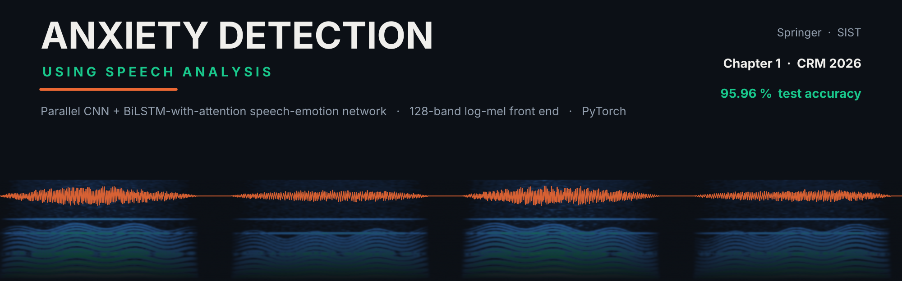

---

## 1 · Dataset

  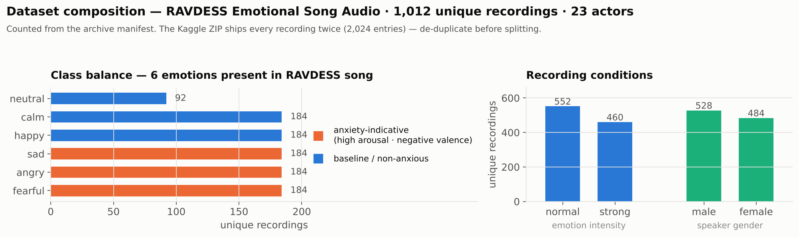

**Dataset composition** · regenerated from the archive manifest. Five of the
six emotions are exactly balanced at 184 recordings; *neutral* has half the
support because RAVDESS records it at normal intensity only. The subtitle
carries the finding that matters most: the Kaggle ZIP ships every recording
twice. → [`DATASET.md`](DATASET.md)

<table>
<tr>
<td width="33%" align="center">
  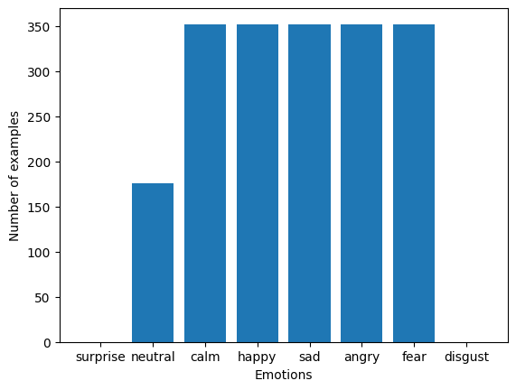 
  <b>Emotions, as indexed</b> The notebook's own count over an
  8-class axis — <i>surprise</i> and <i>disgust</i> sit at zero because they
  do not exist in the song subset.
</td>
<td width="33%" align="center">
  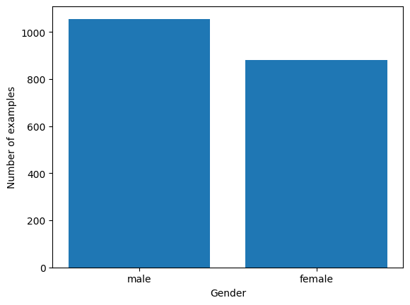 
  <b>Speaker gender</b> Near-balanced across 12 male and 11 female
  actors.
</td>
<td width="33%" align="center">
   
  <b>Emotion intensity</b> Normal takes outnumber strong ones,
  because neutral has no strong variant.
</td>
</tr>
</table>

---

## 2 · Feature front end

  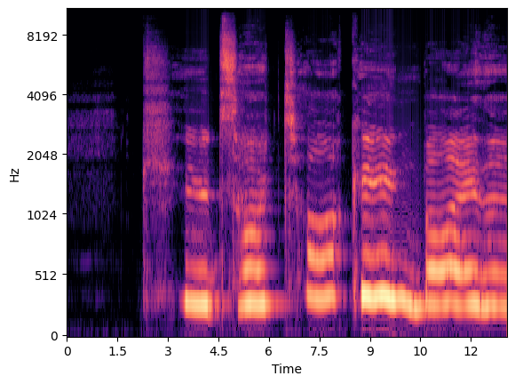

**128-band log-mel spectrogram** of a single 3-second clip — the only thing
the network ever sees. Horizontal bands are the harmonic stack of the sung
vowel; their spacing tracks pitch, and their relative energy tracks timbre.
`n_fft 1024 · win 512 · hop 256 · Hamming · fmax 24 kHz` → a **128 × 563**
matrix. → [`METHODOLOGY.md`](METHODOLOGY.md)

---

## 3 · Training

  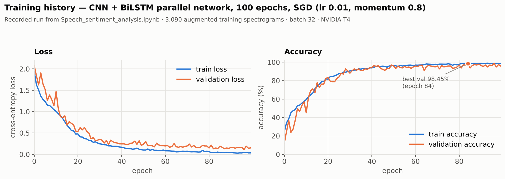

**100 epochs, regenerated from [`data/training_history.csv`](data/training_history.csv).**
Train and validation curves track each other throughout — no overfitting gap.
Accuracy passes 95 % around epoch 42; the best validation accuracy, 98.45 %,
lands at epoch 84 and again at 96. → [`RESULTS.md`](RESULTS.md)

---

## 4 · Results

<table>
<tr>
<td width="50%" align="center">
  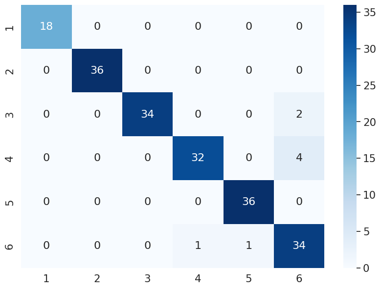 
  <b>Confusion matrix</b> — strongly diagonal on the 198-clip test fold.
</td>
<td width="50%" align="center">
  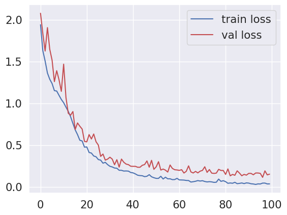 
  <b>Loss curves</b> — the notebook's own plot (blue train, red validation).
</td>
</tr>
<tr>
<td width="50%" align="center">
  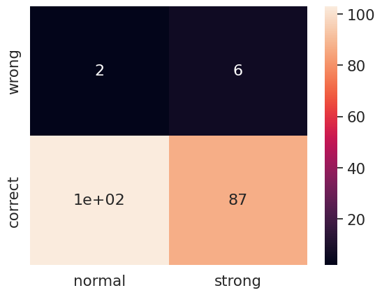 
  <b>By emotion intensity</b> — correct vs incorrect, normal vs strong.
</td>
<td width="50%" align="center">
  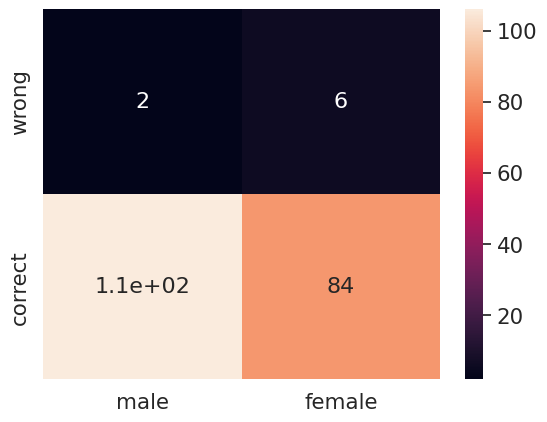 
  <b>By speaker gender</b> — correct vs incorrect, male vs female.
</td>
</tr>
</table>

---

## 5 · Emotion → anxiety

  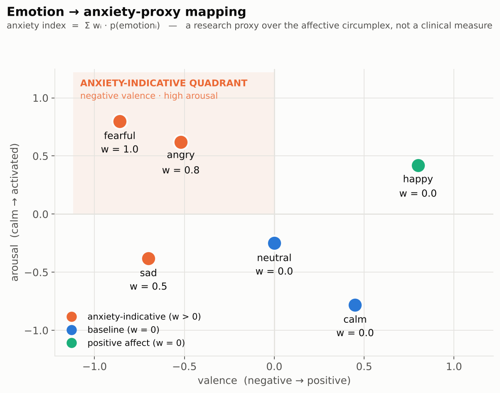

**The mapping that turns an emotion posterior into an anxiety index.** Each
emotion sits where it falls on the affective circumplex; the shaded quadrant
— negative valence, high arousal — is the region anxious speech occupies, and
the weights `w` are the contribution each class makes to
`Σ wᵢ · p(emotionᵢ)`. A research proxy, not a clinical measure.
→ [`MODEL_CARD.md`](MODEL_CARD.md)

---

### Provenance

| Figure | Source |
|---|---|
| `hero-banner.png` | generated · `docs/images/` |
| `dataset-composition.png` | generated from `docs/data/dataset_composition.csv` |
| `training-history.png` | generated from `docs/data/training_history.csv` |
| `anxiety-mapping.png` | generated from `config.ANXIETY_WEIGHTS` |
| `notebook/*.png` | captured from the executed `Speech_sentiment_analysis.ipynb` |
