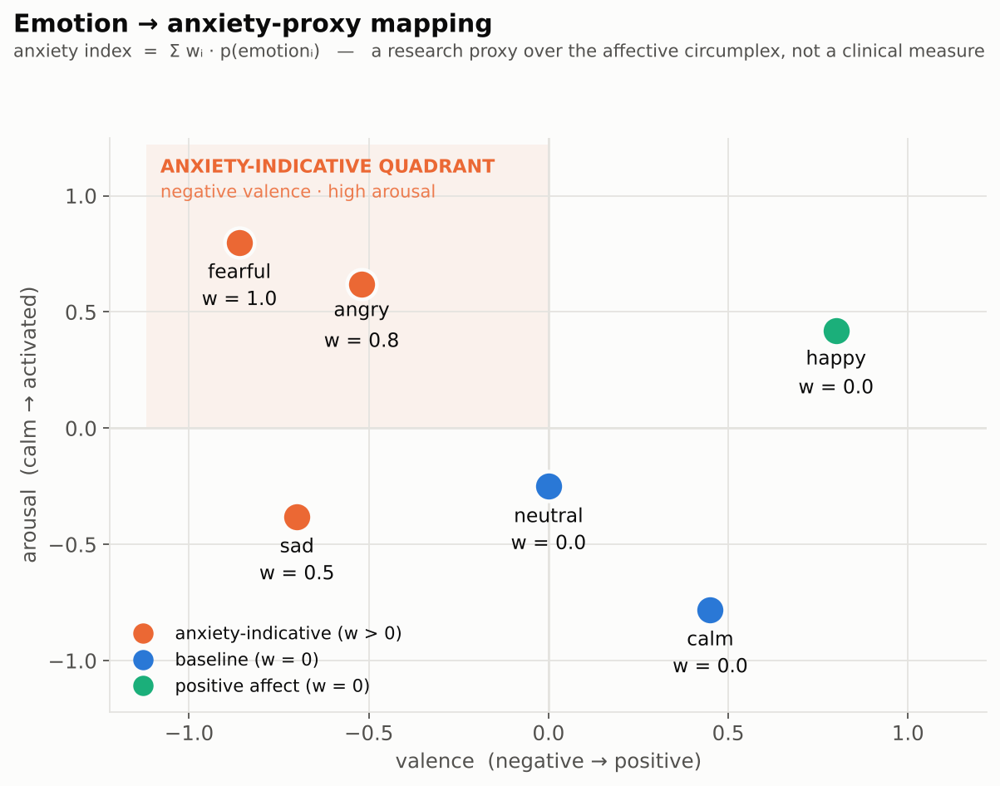

# 🔬 Methodology

End-to-end description of the pipeline, in the order the data moves. Every
parameter below is the published setting and is defined once in
[`src/anxiety_speech/config.py`](../src/anxiety_speech/config.py).

## 1 · Indexing

Walk the dataset root, parse each RAVDESS filename into
`(label, intensity, statement, repetition, actor, gender)`, and drop any file
that is not an audio-only song clip. Duplicate filename stems are removed,
keeping the shallowest path.

```python
from anxiety_speech.data import build_index, summarise
frame = build_index("data/ravdess")
print(summarise(frame))
```

## 2 · Splitting

Two protocols ship, and the choice changes what the resulting number means.

### `--split speaker` (default, recommended)

Actors are partitioned, not recordings: **no actor appears in two folds**.
A model cannot score well by recognising a familiar voice, so the result
measures emotion recognition rather than speaker memorisation. This is the
protocol to use for any figure you intend to publish or compare.

### `--split stratified` (reproduces the notebook)

Class-stratified random 80/10/10 over recordings. Actors are shared across
folds, so the same voice — and, on the un-de-duplicated archive, the same
*file* — can appear on both sides. Retained for reproducibility of the
published run.

```python
from anxiety_speech.data import split_by_speaker
train, val, test = split_by_speaker(frame, val_fraction=0.1, test_fraction=0.1, seed=42)
```

## 3 · Waveform loading

Each clip is loaded at **48 kHz**, starting **0.5 s** in to skip the leading
silence, for a fixed **3 s** window:

* shorter clips → zero-padded on the right
* longer clips → trimmed

giving exactly **144,000 samples** per recording and a rectangular tensor with
no ragged-batch handling.

## 4 · Augmentation — additive white Gaussian noise

Applied to the **training fold only**, after the split, which doubles it. For
each clip an SNR is drawn uniformly from **[15, 30) dB** and the noise is
scaled to hit it:

$$K = \sqrt{\frac{P_{\text{signal}}}{P_{\text{noise}}} \cdot 10^{-\mathrm{SNR}/10}},
\qquad x' = x + K \cdot n,\quad n \sim \mathcal{N}(0, 1)$$

Powers are computed on 16-bit-normalised signals. The point is robustness to
recording conditions: RAVDESS is studio-clean, and a model trained only on
clean audio degrades sharply on anything else.

> Augmenting **after** the split is essential. Augment first and a clip's
> noisy twin lands in the test fold — the same leak as the duplicated archive,
> self-inflicted.

## 5 · Log-mel front end

| Parameter | Value |
|---|---|
| FFT size | 1024 |
| window | Hamming, length 512 |
| hop | 256 samples (≈ 5.3 ms at 48 kHz) |
| mel bands | 128 |
| `fmax` | 24 kHz (Nyquist) |
| scaling | power → dB, referenced to each clip's maximum |

Output: **128 × 563** per clip.

## 6 · Standardisation

Spectrograms are flattened to `(N, 128·563)` and standardised per feature.
The scaler is **fitted on the training fold only**, then applied unchanged to
validation and test — and saved inside the checkpoint, so inference reproduces
training-time normalisation exactly.

## 7 · Training

| Setting | Value |
|---|---|
| optimiser | SGD |
| learning rate | 0.01 |
| momentum | 0.8 |
| weight decay | 1e-3 |
| batch size | 32 |
| epochs | 100 |
| loss | cross-entropy over logits |
| shuffling | full permutation each epoch |
| checkpointing | best validation accuracy |

```bash
python -m anxiety_speech.train --data-root data/ravdess --split speaker --out artifacts/
```

Each epoch writes a row of `history.json`; the best checkpoint carries the
model weights, the fitted scaler, and the configs used to build both.

## 8 · Evaluation

Accuracy, weighted recall, weighted and macro F1, a full confusion matrix, a
per-class report, and accuracy broken down by **speaker gender** and
**emotion intensity** — the two subgroup axes RAVDESS metadata supports.

```bash
python -m anxiety_speech.evaluate --checkpoint artifacts/best_model.pt \
    --split-csv artifacts/split_test.csv --out artifacts/
```

Macro F1 is reported alongside the weighted figure because neutral has half
the support of every other class; a weighted average hides what happens there.

## 9 · Emotion → anxiety index

The classifier predicts emotion; the application needs an anxiety reading.
The posterior is projected onto the high-arousal / negative-valence region of
the affective circumplex:

$$\text{anxiety index} = \sum_i w_i \cdot p(\text{emotion}_i),
\qquad w = \{\text{fearful}: 1.0,\ \text{angry}: 0.8,\ \text{sad}: 0.5,\ \text{else}: 0\}$$

<p align="center">
  
</p>

| Index | Band |
|---|---|
| < 0.20 | low |
| 0.20 – 0.50 | moderate |
| 0.50 – 0.75 | elevated |
| ≥ 0.75 | high |

The weights are a documented modelling choice, not a fitted quantity — they
are a hypothesis about which acted emotions resemble anxious speech. They live
in `config.ANXIETY_WEIGHTS` and are meant to be edited and re-justified for
any new deployment. **This is a research proxy, not a clinical measure**; see
[`MODEL_CARD.md`](MODEL_CARD.md).

## Reproducing the published run exactly

```bash
python -m anxiety_speech.train --data-root data/ravdess \
    --split stratified --keep-duplicates --epochs 100
```

This restores both the notebook's random split and its duplicated index. The
flags are deliberately explicit: reproducing a leak should require asking for
it.
