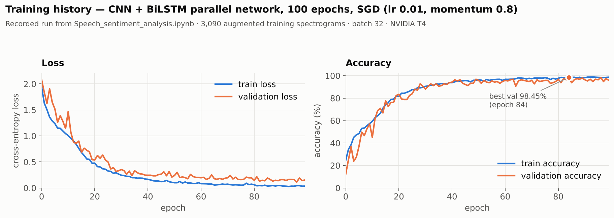
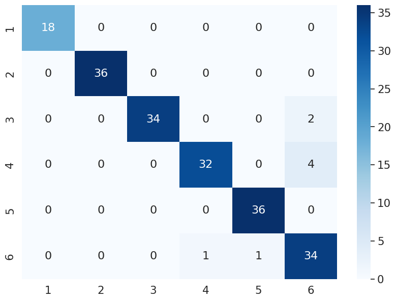
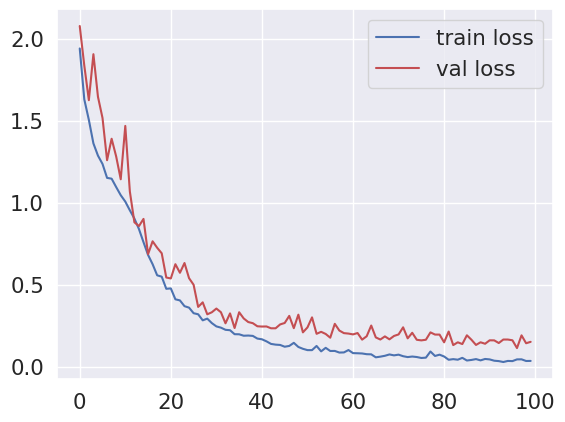
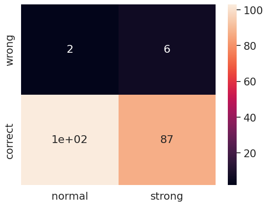
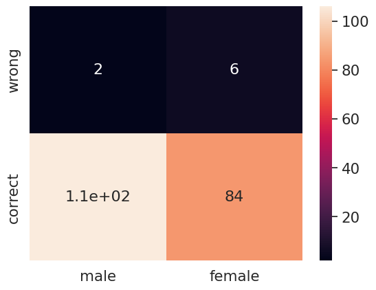

# 📈 Results

All numbers on this page are **measured**, taken from the recorded run in
[`../Speech_sentiment_analysis.ipynb`](../Speech_sentiment_analysis.ipynb).
The per-epoch log is committed as
[`data/training_history.csv`](data/training_history.csv) so every figure here
can be regenerated.

## Headline — as published

| Metric | Value |
|---|---|
| **Test accuracy** | **95.96 %** |
| Test loss | 0.120 |
| Weighted recall | 0.96 |
| Weighted F1 | 0.96 |
| Best validation accuracy | 98.45 % (epochs 84 and 96) |
| Lowest validation loss | 0.1127 (epoch 96) |
| Final epoch (99) | train 98.67 % / val 95.85 % |
| Trainable parameters | 263,593 |
| Hardware | 1 × NVIDIA T4 (Colab) |
| Wall clock | 100 epochs |

Test fold: 198 clips. Train: 3,090 after AWGN augmentation (1,545 originals).
Validation: 193.

## Training dynamics

<p align="center">
  
</p>

Three things are worth reading off this curve:

1. **No overfitting gap.** Train and validation accuracy stay within a few
   points of each other for the whole run, and validation loss keeps falling
   with training loss. Dropout (0.3 convolutional, 0.1 recurrent), weight
   decay and the AWGN augmentation are doing their job.
2. **Convergence by ~epoch 40.** Accuracy is above 95 % from epoch 42 onward;
   the remaining 58 epochs buy roughly two points and a lot of variance. A
   patience-based early stop would cut training time by more than half.
3. **Validation noise.** The validation fold is 193 clips, so one
   misclassification moves the number by 0.52 %. The epoch-to-epoch jitter of
   ±2 % late in training is sampling noise, not instability.

## Confusion matrix and subgroup behaviour

<table>
<tr>
<td width="50%" align="center">
  <br/>
  <sub><b>Confusion matrix</b> — test fold. Near-diagonal; the residual
  confusion is concentrated between <i>calm</i> and <i>neutral</i>, which are
  acoustically adjacent.</sub>
</td>
<td width="50%" align="center">
  <br/>
  <sub><b>Loss curves</b> — the notebook's own plot of the same run
  (blue = train, red = validation).</sub>
</td>
</tr>
<tr>
<td width="50%" align="center">
  <br/>
  <sub><b>By emotion intensity</b> — correct vs incorrect for
  <i>normal</i> and <i>strong</i> takes.</sub>
</td>
<td width="50%" align="center">
  <br/>
  <sub><b>By speaker gender</b> — correct vs incorrect for male and
  female actors.</sub>
</td>
</tr>
</table>

Both subgroup panels are close to balanced, which is the result you want: the
model is not trading accuracy on one group for another on this test fold. The
fold is small (198 clips), so these are indicative rather than conclusive —
`anxiety_speech.evaluate` recomputes them with explicit counts and
per-subgroup accuracy.

## ⚠️ How to read 95.96 %

The headline number is a faithful report of the run that was executed. Two
properties of that run inflate it relative to what the model would score on
unseen speakers, and both are documented here rather than buried:

**1 · The archive is duplicated.** The Kaggle mirror ships every recording
twice (2,024 entries, 1,012 unique — see [`DATASET.md`](DATASET.md)). The
notebook indexed 1,936 rows, so near-duplicate pairs exist in the index, and
the random split can place a file and its twin on opposite sides. Some test
clips were therefore almost certainly seen in training.

**2 · The split is not speaker-independent.** Even with duplicates removed, a
class-stratified random split shares actors between train and test. The model
can partly identify *how a particular actor performs fear* instead of how fear
sounds in general. Speaker-independent evaluation on RAVDESS typically lands
well below same-speaker evaluation.

Neither point is a defect in the architecture — it is how the headline number
should be interpreted. The repository therefore ships the leakage-safe path as
the **default**:

```bash
# honest protocol: de-duplicated index, no actor shared between folds
python -m anxiety_speech.train --data-root data/ravdess --split speaker
```

and the published protocol behind explicit opt-in flags:

```bash
# reproduce the notebook exactly, leak included
python -m anxiety_speech.train --data-root data/ravdess \
    --split stratified --keep-duplicates
```

Speaker-independent numbers are **not** quoted here, because that run has not
been executed in this repository — publishing an unmeasured figure would be
the same error in the other direction. Run the first command and
`evaluate.py` will write `metrics.json`; a pull request adding the result is
welcome.

## Reproducing the figures

```bash
python -m anxiety_speech.evaluate \
    --checkpoint artifacts/best_model.pt \
    --split-csv artifacts/split_test.csv \
    --out artifacts/
```

Writes `metrics.json`, `confusion_matrix.csv`, and `predictions.csv` (one row
per clip, with its anxiety index).
